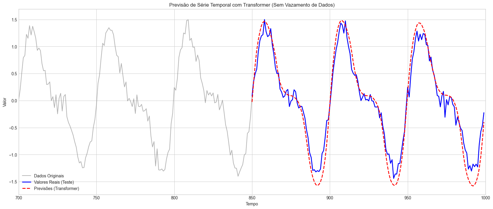
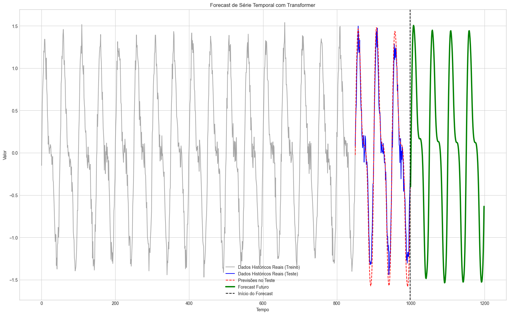

# Previsão de Séries Temporais com Transformer e PyTorch

## 1. Sobre o projeto

Este projeto tem como objetivo explorar a aplicação de Deep Learning na previsão de séries temporais, utilizando a arquitetura **Transformer**, implementada com a biblioteca PyTorch.

A previsão de séries temporais possui diversas possibilidades de aplicação no contexto industrial, especialmente no acompanhamento de variáveis de processo, como temperatura, pressão, vazão e outras grandezas operacionais.

A capacidade de identificar padrões temporais e estimar comportamentos futuros pode contribuir para o monitoramento de processos, o planejamento operacional e o desenvolvimento de soluções de Inteligência Artificial Industrial.

Neste estudo, foi utilizada uma série temporal sintética para desenvolver e avaliar o modelo em um ambiente controlado.

## 2. Objetivos

- Explorar a aplicação da arquitetura Transformer em problemas de previsão de séries temporais.
- Compreender o funcionamento da codificação posicional e dos mecanismos de atenção.
- Desenvolver um modelo capaz de aprender padrões temporais a partir de dados históricos.
- Avaliar o desempenho do modelo por meio de métricas estatísticas.
- Explorar a previsão autorregressiva de múltiplos passos.

## 3. Metodologia

O desenvolvimento foi dividido nas seguintes etapas:

### 3.1. Geração e análise dos dados

Foi criada uma série temporal sintética composta por duas funções senoidais com diferentes frequências e um componente de ruído aleatório.

Essa abordagem permite simular comportamentos periódicos e variações nos dados, criando uma base para o desenvolvimento do modelo.

### 3.2. Divisão entre treino e teste

A série temporal foi dividida cronologicamente, utilizando 80% das observações para treinamento e 20% para teste.

Essa estratégia respeita a ordem temporal dos dados, permitindo avaliar o modelo em observações posteriores às utilizadas durante o treinamento.

### 3.3. Normalização dos dados

Foi utilizado o MinMaxScaler para reescalar os valores da série para o intervalo entre -1 e 1.

O ajuste do normalizador foi realizado exclusivamente com os dados de treinamento, sendo posteriormente aplicado aos dados de teste. Esse procedimento evita o vazamento de informações entre os conjuntos.

### 3.4. Criação das sequências temporais

Foram utilizadas janelas deslizantes (*sliding windows*) de 50 observações consecutivas para prever o próximo valor da série.

Dessa forma, o modelo utiliza o histórico recente como entrada para aprender os padrões temporais e estimar a observação seguinte.

### 3.5. Construção da arquitetura Transformer

O modelo foi desenvolvido utilizando PyTorch, contemplando os seguintes componentes:

- Camada de codificação da entrada (*Encoder*);
- Codificação posicional (*Positional Encoding*);
- Mecanismo de atenção (*Self-Attention*);
- Atenção com múltiplas cabeças (*Multi-Head Attention*);
- Camadas Feedforward;
- Camada de saída (*Decoder*).

A arquitetura permite explorar as relações entre as observações presentes na janela temporal, identificando padrões relevantes para a previsão.

### 3.6. Treinamento do modelo

O treinamento foi realizado utilizando o otimizador Adam e a função de perda Mean Squared Error (MSE).

Durante essa etapa, os parâmetros da rede neural foram ajustados para minimizar a diferença entre os valores previstos e os valores reais.

### 3.7. Avaliação do modelo

O desempenho foi avaliado por meio das seguintes métricas:

- **MAE (Mean Absolute Error):** erro absoluto médio entre os valores previstos e reais.
- **MSE (Mean Squared Error):** média dos erros quadráticos.
- **RMSE (Root Mean Squared Error):** raiz quadrada do erro quadrático médio.

Também foi realizada uma comparação gráfica entre os valores reais do conjunto de teste e as previsões geradas pelo modelo.

### 3.8. Previsão futura

Por fim, foi implementada uma estratégia de previsão autorregressiva (*Autoregressive Forecasting*).

Nesse procedimento, cada valor previsto é incorporado à sequência de entrada para gerar a previsão seguinte, permitindo estimar múltiplos passos futuros sem a necessidade de fornecer novas observações reais.

## 4. Resultados

O modelo foi capaz de reproduzir boa parte do comportamento periódico presente na série temporal sintética.

A comparação entre os valores reais e previstos permite observar a capacidade do Transformer de acompanhar as principais oscilações dos dados.

Também foi explorada a previsão de múltiplos passos futuros, demonstrando como o modelo projeta os padrões temporais aprendidos para observações posteriores.

### 4.1. Comparação entre valores reais e previstos

O gráfico apresenta a comparação entre os valores reais do conjunto de teste e as previsões geradas pelo modelo Transformer.



### 4.2. Previsão de valores futuros

Após a avaliação, foi realizada uma previsão autorregressiva de múltiplos passos, utilizando os valores estimados pelo modelo para gerar as previsões seguintes.



## 5. Aplicações potenciais no contexto industrial

A metodologia estudada pode ser explorada em diferentes problemas de engenharia e operações industriais, como:

- Previsão de temperatura em reatores e equipamentos;
- Monitoramento de pressão e vazão em processos;
- Análise de tendências de variáveis operacionais;
- Apoio ao desenvolvimento de estratégias de manutenção preditiva;
- Integração com soluções de Gêmeos Digitais (*Digital Twins*).

É importante destacar que este projeto utiliza dados sintéticos. Portanto, os resultados demonstram a aplicação da arquitetura em um cenário controlado, não representando ainda uma validação com dados reais de processos industriais.

## 6. Tecnologias utilizadas

- Python
- PyTorch
- NumPy
- Pandas
- Matplotlib
- Scikit-learn

## 7. Estrutura do repositório

```text
transformer-time-series-forecasting/
│
├── arquitetura_transformers.ipynb
└── README.md
```

## 8. Considerações finais

O desenvolvimento deste projeto proporcionou o aprofundamento dos conhecimentos em séries temporais, preparação de dados, arquiteturas de Deep Learning e aplicação de Transformers.

Além da implementação do modelo, o estudo permitiu compreender os principais componentes da arquitetura e explorar seu potencial em problemas relacionados à previsão de variáveis de processos industriais.

O próximo passo é investigar a aplicação dessas técnicas em dados industriais reais, considerando as características físicas dos processos, a confiabilidade das previsões e sua utilidade para a tomada de decisão.

---

**Desenvolvido como parte dos estudos em Data Science, Deep Learning e Inteligência Artificial aplicada à Engenharia.**
